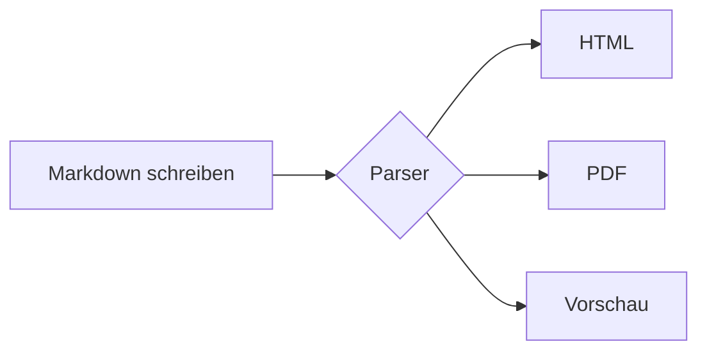

# Überschrift 1 (H1)
## Überschrift 2 (H2)
### Überschrift 3 (H3)
#### Überschrift 4 (H4)
##### Überschrift 5 (H5)
###### Überschrift 6 (H6)

Alternativer Stil für H1
===

Alternativer Stil für H2
---

---

## 1. Textformatierung

* **Fetter Text** mit zwei Sternchen oder __zwei Unterstrichen__
* *Kursiver Text* mit einem Sternchen oder _einem Unterstrich_
* ***Fett und kursiv kombiniert*** mit drei Sternchen
* ~~Durchgestrichener Text~~ mit zwei Tilden
* ==Markierter Text== (wird von vielen Editoren wie Obsidian oder MarkText unterstützt)
* H~2~O (Tiefgestellt – erweiterte Syntax / HTML `<sub>`)
* X^2^ (Hochgestellt – erweiterte Syntax / HTML `<sup>`)
* <kbd>Strg</kbd> + <kbd>C</kbd> (Tastaturbefehle über HTML-Tag)

---

## 2. Absätze und Zeilenumbrüche

Dies ist ein normaler Absatz. Um einen neuen Absatz zu beginnen, lässt man einfach eine Zeile frei.

Wenn du innerhalb eines Absatzes einen harten Zeilenumbruch erzwingen möchtest,  
füge am Ende der Zeile zwei Leerzeichen ein oder nutze ein `<br>`.

---

## 3. Zitate (Blockquotes)

> Dies ist ein einfaches Zitat.
> Es kann sich über mehrere Zeilen erstrecken.
>
> > Verschachtelte Zitate sind ebenfalls möglich.
> > — *Autor des Zitats*

---

## 4. Listen

### Ungeordnete Liste
* Punkt A
* Punkt B
  * Unterpunkt B.1 (mit 2 Leerzeichen eingerückt)
  * Unterpunkt B.2
    * Unter-Unterpunkt B.2.1
- Alternativ mit Bindestrich
+ Oder mit Pluszeichen

### Geordnete (nummerierte) Liste
1. Erster Schritt
2. Zweiter Schritt
   1. Unterschritt 2.1
   2. Unterschritt 2.2
3. Dritter Schritt

### Aufgabenliste (Task List / Checkboxes)
- [x] Markdown-Grundlagen lernen
- [x] Datei lokal als `.md` speichern
- [ ] Eigene Dokumentation schreiben

### Definitionsliste (erweiterte Syntax)
Markdown
: Eine leichtgewichtige Auszeichnungssprache zur Formatierung von Text.

CommonMark
: Eine standardisierte Spezifikation für Markdown.

---

## 5. Links und Bilder

### Links
* [Direkter Link mit Titel](https://markdownguide.org "Zur offiziellen Markdown-Dokumentation")
* Automatischer Link: <https://github.com>
* E-Mail-Link: <beispiel@domain.de>
* [Referenz-Link][ref-id]
* [Sprungmarke zu Kapitel 1](#1-textformatierung)

[ref-id]: https://commonmark.org "CommonMark Spezifikation"

### Bilder


Verlinktes Bild:
[](https://markdownguide.org)

---

## 6. Code und Syntax-Highlighting

Inline-Code wird mit einfachen Backticks dargestellt, wie zum Beispiel `console.log("Hallo Welt")`.

Für mehrzeilige Codeblöcke nutzt man drei Backticks inklusive der Programmiersprache:

```python
def begruessung(name: str) -> str:
    """Gibt eine personalisierte Begrüßung zurück."""
    return f"Hallo, {name}! Willkommen bei Markdown."

print(begruessung("Max"))
```

```json
{
  "format": "Markdown",
  "dateiendung": ".md",
  "version": 1.0,
  "features": ["Tabellen", "Codeblöcke", "Checklisten"]
}
```

---

## 7. Tabellen

Spalten werden durch Pipes (`|`) getrennt. Die Ausrichtung wird über Doppelpunkte (`:`) in der Trennzeile gesteuert:

| Links ausgerichtet | Zentriert | Rechts ausgerichtet |
| :--- | :---: | ---: |
| Text A | Wert 1 | 10,00 € |
| Text B | Wert 2 | 250,50 € |
| Text C | Wert 3 | 1.999,99 € |

---

## 8. Trennlinien (Horizontal Rules)

Drei oder mehr Bindestriche, Sternchen oder Unterstriche erzeugen eine horizontale Linie:

---
***
___

---

## 9. Fußnoten (erweiterte Syntax)

Hier steht ein Satz mit einer Fußnote[^1] und noch einer weiteren Erklärung[^hinweis].

[^1]: Das ist der Text der ersten Fußnote am Ende des Dokuments.
[^hinweis]: Fußnoten können auch benannte IDs statt Zahlen verwenden.

---

## 10. Hinweiskästen / Alerts (GitHub & Obsidian Syntax)

> [!NOTE]
> Nützliche Informationen, die Nutzer auch beim schnellen Überfliegen beachten sollten.

> [!TIP]
> Hilfreiche Ratschläge, um Aufgaben besser oder schneller zu erledigen.

> [!IMPORTANT]
> Wichtige Informationen, die für das Gelingen entscheidend sind.

> [!WARNING]
> Dringender Hinweis zur Vermeidung von Problemen.

> [!CAUTION]
> Warnung vor möglichen negativen Auswirkungen bestimmter Aktionen.

---

## 11. Mathematische Formeln (LaTeX / MathJax)

Inline-Mathematik: Die bekannte Formel lautet $E = mc^2$.

Block-Mathematik:

$$
f(x) = \int_{-\infty}^\infty \hat f(\xi)\,e^{2 \pi i \xi x} \,d\xi
$$

---

## 12. Diagramme (Mermaid.js)

Viele moderne Plattformen (GitHub, GitLab, Obsidian, Notion) rendern Mermaid-Code direkt als Grafik:



---

## 13. Sonderzeichen maskieren (Escaping)

Mit einem Backslash (`\`) verhinderst du, dass Sonderzeichen als Formatierung interpretiert werden:

\*Dieser Text ist nicht kursiv\*  
\# Das ist keine Überschrift  
\[Das ist kein Link\]

---

## 14. Einklappbare Bereiche (HTML-Details)

Da Markdown reines HTML unterstützt, lassen sich Spoiler oder Zusatzinfos einklappen:

<details>
<summary>Klicke hier, um den versteckten Inhalt anzuzeigen</summary>

Hier steht der **formatierte Inhalt**, der erst nach dem Aufklappen sichtbar wird.
- Auch Listen funktionieren hier drin.
</details>

